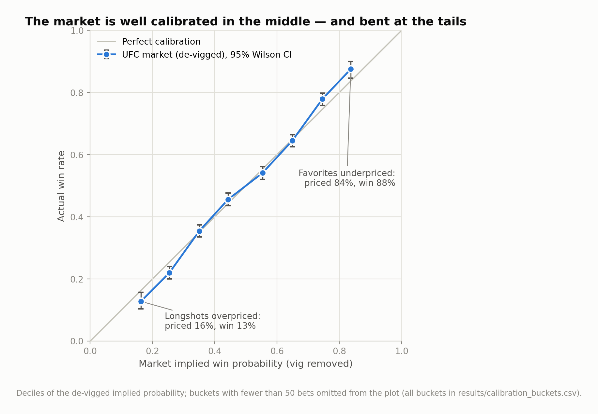
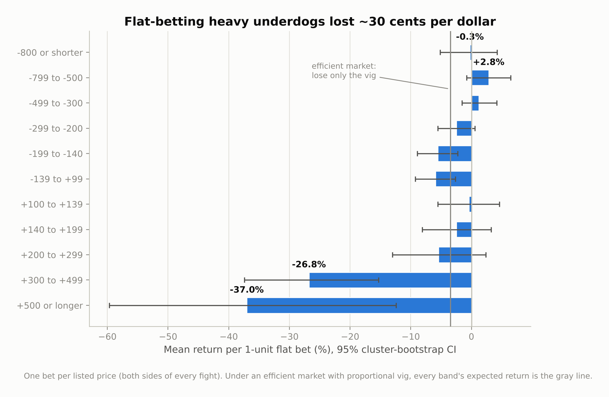
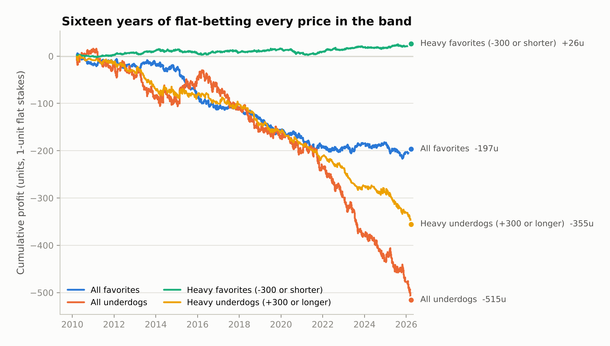
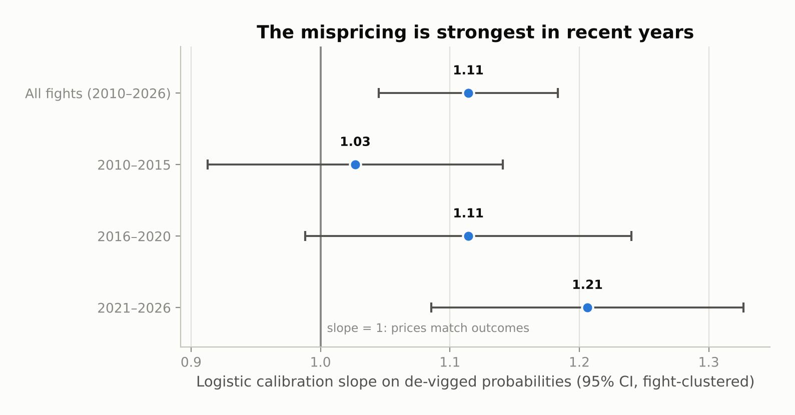
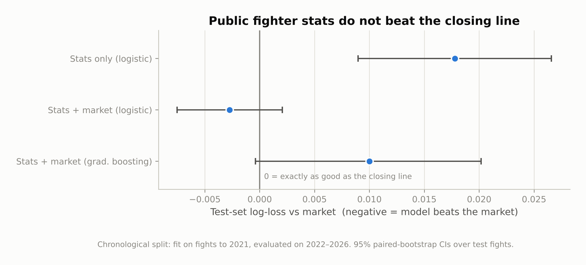

# The Favorite–Longshot Bias in MMA Betting Markets

**Do betting markets misprice UFC fights when one fighter is a massive favorite?**
Statistical evidence from ~6,900 UFC bouts (2010–2026) with closing moneyline odds: yes — in the
direction the favorite–longshot bias literature predicts, by an economically large margin, and
persistently.



The same curve with **equal-count bins** — 27 quantile buckets of ~500 bets each, grouped by nearest
market price so every point carries the same statistical power — bends identically at the tails:
[figures/calibration_equal_count.png](figures/calibration_equal_count.png). (A curiosity that
surfaced while building it: at exact pick'em prices the red corner wins 62.5% of 120 fights —
corner assignment carries information the price ignores.)

## Headline results

The market is almost perfectly calibrated through the middle of the probability range, but bent at
the tails. Longshots win less often than their price implies, and heavy favorites win more.

| Test | Result |
|---|---|
| Logistic calibration slope on de-vigged probabilities (1 = efficient) | **1.114** (SE 0.035), H₀: slope = 1 rejected, p = 0.001 |
| Same test with Shin (1993) insider-trading de-vigging (conservative) | **1.068**, p = 0.046 — the bias survives |
| Heavy underdogs (+300 or longer, n = 1,219 bets): implied vs. actual win rate | priced **19.1%**, won **14.0%** |
| Flat-bet return, +300 to +499 underdogs (n = 937) | **−26.8%** per unit [95% CI −37.4, −15.3] vs. −3.4% vig-only benchmark |
| Flat-bet return, +500 or longer underdogs (n = 282) | **−37.0%** per unit [−59.7, −12.4] |
| Flat-bet return, heavy favorites −300 or shorter (n = 1,804) | **+1.5%** per unit [−0.7, +3.6] — above the vig-only benchmark |
| Return-vs-price trend (OLS, fight-clustered) | slope +0.258, t = 3.76, p < 0.001: shorter prices are better bets |
| Can public fighter stats beat the closing line? (2022–2026 out-of-sample) | **No** — best model improves log-loss by a statistically indistinguishable −0.003 |

A bookmaker margin of ~4.8% cannot explain a 30-cents-per-dollar loss on heavy underdogs. That is
probability mispricing, not friction.



Sixteen years of 1-unit flat stakes makes the asymmetry visible: betting every −300-or-shorter
favorite ends **up 26 units** (1,804 bets, through the vig), while betting every +300-or-longer
underdog loses **355 units** (1,219 bets).



Two further results sharpen the picture. First, the bias is not a relic of the early, soft MMA
market — the calibration slope rises across eras (1.03 in 2010–2015, 1.11 in 2016–2020, **1.21** in
2021–2026, where efficiency is rejected on that era alone). Second, the mispricing coexists with
*informational* efficiency: models built on public pre-fight statistics (records, physical
attributes, streaks, striking/grappling averages) do **not** beat the de-vigged closing line out of
sample, so the anomaly is a systematic tail distortion — consistent with recreational demand for
longshots and parlays — rather than a market that ignores public information.




## Methodology

**Data.** The [Ultimate UFC Dataset](https://www.kaggle.com/datasets/mdabbert/ultimate-ufc-dataset)
(Apache-2.0, mirrored on [GitHub](https://github.com/shortlikeafox/ultimate_ufc_dataset)): every UFC
bout from March 2010 to March 2026 with closing American moneyline odds and pre-fight career stats.
Fights are kept if both sides have odds and the booksum is plausible (1 < r < 1.25); draws and
no-contests (< 0.15% of bouts) are excluded from calibration and treated as pushes conceptually.
Clean public odds histories do not exist for Bellator/PFL/ONE, so the sample is UFC; the pipeline in
`src/` is promotion-agnostic.

**Probabilities.** American odds → raw implied probabilities → de-vigged two ways: proportional
normalization (the standard baseline) and **Shin's (1993)** method, which models bookmakers
defending against insiders and therefore shades longshots — any bias surviving Shin is a
conservative finding. Both are implemented and unit-tested in `src/mma_efficiency/odds.py`.

**Inference.** The unit of observation is one *price* (two per fight), and the two sides of a fight
are mirror images — so nothing here pretends they are independent: the logistic calibration test
(Mincer–Zarnowitz on the logit scale, H₀: intercept 0, slope 1) uses fight-clustered standard
errors, all return CIs come from a cluster bootstrap that resamples whole fights, per-bucket exact
binomial tests carry Benjamini–Hochberg FDR correction, and buckets that could contain both sides of
one fight are de-duplicated. The efficient-market benchmark for flat-bet returns is 1/r − 1 (lose
the vig, nothing more), which under proportional vig is identical for every price — what makes the
return-by-band profile a valid test.

**ML benchmark (semi-strong efficiency).** One row per fight oriented favorite-vs-underdog (so the
red/blue corner assignment can't leak), features computed directly from per-corner career columns,
chronological train/test split (≤2021 / 2022–2026), evaluated on out-of-sample log-loss against the
market's own probability with paired-bootstrap CIs — plus an edge-threshold betting simulation
against raw (vig-included) prices.

## Repository layout

```
├── run_analysis.py          # one command: data → tests → results/ → figures/
├── src/mma_efficiency/
│   ├── odds.py              # odds conversions, vig removal (proportional, power, Shin)
│   ├── data.py              # download, cleaning, fight- and side-level tables
│   ├── calibration.py       # Wilson CIs, calibration buckets, clustered logistic test, FDR
│   ├── returns.py           # returns by band, cluster bootstrap, strategy backtests
│   ├── models.py            # ML benchmark vs the closing line
│   └── plots.py             # publication figures
├── notebooks/analysis.ipynb # the full narrative analysis, executed
├── tests/                   # 16 unit tests (pytest)
├── figures/                 # generated PNGs (committed)
└── results/                 # generated tables: CSVs + summary.json (committed)
```

## Reproduce

```bash
git clone <this-repo> && cd <this-repo>
pip install -r requirements.txt
python run_analysis.py        # downloads the data (~3 MB), runs everything (~2 min)
pytest                        # unit tests for the statistical machinery
```

Python ≥ 3.10. The dataset downloads automatically on first run; pin `data/ufc-master.csv` yourself
if you want a frozen snapshot.

## References

Shin, H.S. (1993), *Measuring the Incidence of Insider Trading in a Market for State-Contingent
Claims*, Economic Journal. · Snowberg, E. & Wolfers, J. (2010), *Explaining the Favorite–Long Shot
Bias: Is it Risk-Love or Misperceptions?*, Journal of Political Economy. · Štrumbelj, E. (2014),
*On determining probability forecasts from betting odds*, International Journal of Forecasting. ·
Griffith, R.M. (1949), *Odds adjustments by American horse-race bettors*, American Journal of
Psychology.

## Disclaimer

This is a statistical study of historical closing lines. It ignores bet limits, fees, line movement
and availability, and it is **not** betting advice: the one "profitable" cell (heavy favorites,
+1.5%) is economically thin with a confidence interval touching zero. The robust finding is the
asymmetry, not a money machine.

## License

MIT — see [LICENSE](LICENSE). Dataset © its authors under Apache-2.0, credited above.
