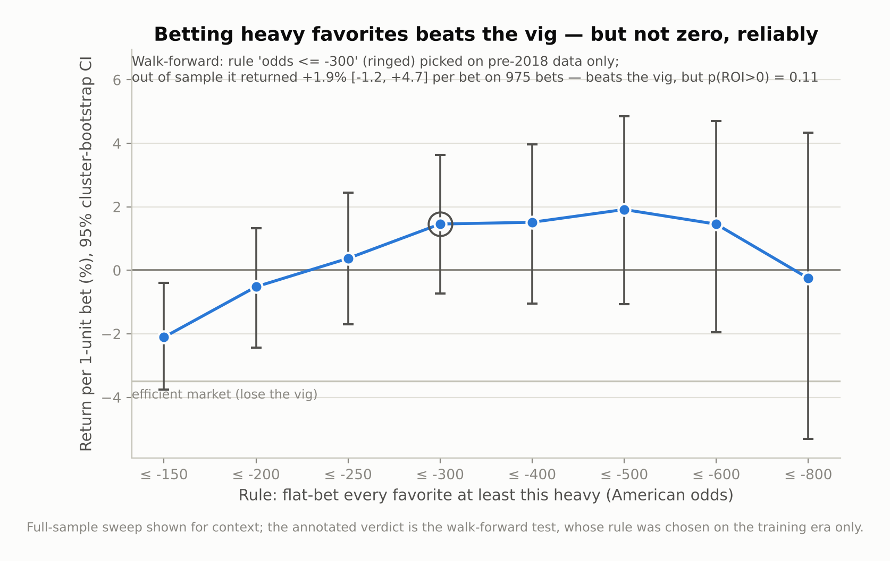
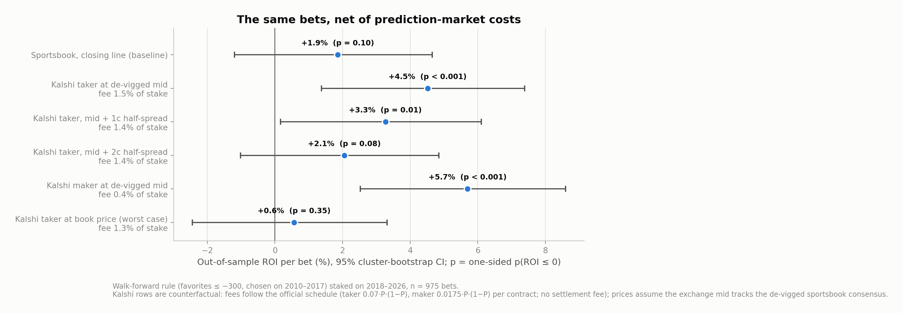
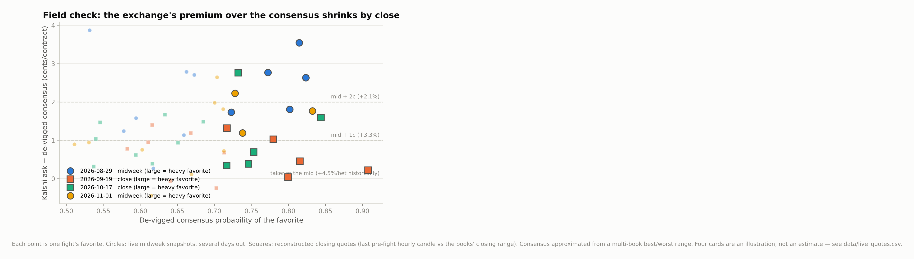

# The Favorite–Longshot Bias in MMA Betting Markets

**Do betting markets misprice UFC fights when one fighter is a massive favorite?**
Statistical evidence from ~6,900 UFC bouts (2010–2026) with closing moneyline odds: yes — in the
direction the favorite–longshot bias literature predicts, by an economically large margin, and
persistently.


The same curve with **equal-count bins** — 27 quantile buckets of ~500 bets each, grouped by nearest
market price so every point carries the same statistical power — bends identically at the tails:
[figures/calibration_equal_count.png](figures/calibration_equal_count.png). (A curiosity that
surfaced while building it: at exact pick'em prices the red corner wins 62.5% of 120 fights —
corner assignment carries information the price ignores.)

## Headline results

The market is almost perfectly calibrated through the middle of the probability range, but bent at
the tails. Longshots win less often than their price implies, and heavy favorites win more.

| Test | Result |
|---|---|
| Logistic calibration slope on de-vigged probabilities (1 = efficient) | **1.114** (SE 0.035), H₀: slope = 1 rejected, p = 0.001 |
| Same test with Shin (1993) insider-trading de-vigging (conservative) | **1.068**, p = 0.046 — the bias survives |
| Heavy underdogs (+300 or longer, n = 1,219 bets): implied vs. actual win rate | priced **19.1%**, won **14.0%** |
| Flat-bet return, +300 to +499 underdogs (n = 937) | **−26.8%** per unit [95% CI −37.4, −15.3] vs. −3.4% vig-only benchmark |
| Flat-bet return, +500 or longer underdogs (n = 282) | **−37.0%** per unit [−59.7, −12.4] |
| Flat-bet return, heavy favorites −300 or shorter (n = 1,804) | **+1.5%** per unit [−0.7, +3.6] — above the vig-only benchmark |
| Return-vs-price trend (OLS, fight-clustered) | slope +0.258, t = 3.76, p < 0.001: shorter prices are better bets |
| Can public fighter stats beat the closing line? (2022–2026 out-of-sample) | **No** — best model improves log-loss by a statistically indistinguishable −0.003 |
| Walk-forward test of a pre-registered rule (picked on 2010–2017, bet 2018–2026) | favorites ≤ −300: **+1.9%** per bet [−1.2, +4.7] on 975 bets — beats the vig, but p(ROI > 0) = 0.11 |
| Same out-of-sample bets executed on Kalshi (official fee schedule), if the exchange mid tracks the de-vigged consensus | **+4.5%** per bet [+1.4, +7.4], p < 0.001; still +3.3% (p = 0.01) crossing a 1¢ half-spread — but +0.6% (p = 0.35) if the exchange price embeds the book's margin |
| Field check: Kalshi UFC quotes vs the de-vigged multi-book consensus (4 pilot cards, 49 fights, two horizons) | heavy-favorite asks sit **+2.2¢** above the consensus midweek but **+0.9¢** at close (spreads ~1¢, asks sum to ~1.00–1.01) — closing-time taker execution lands between the "mid" and "mid + 1¢" regimes |

A bookmaker margin of ~4.8% cannot explain a 30-cents-per-dollar loss on heavy underdogs. That is
probability mispricing, not friction.


Sixteen years of 1-unit flat stakes makes the asymmetry visible: betting every −300-or-shorter
favorite ends **up 26 units** (1,804 bets, through the vig), while betting every +300-or-longer
underdog loses **355 units** (1,219 bets).


**Is the bias exploitable?** Bias and exploitability are different claims, and the second demands a
stricter test: picking the best-looking rule after seeing all 16 years is data snooping. The
walk-forward test selects a favorite-cutoff rule on 2010–2017 only (by the most pessimistic
criterion, the highest bootstrap lower bound) and stakes it blind on 2018–2026. The selected rule —
flat-bet every favorite at −300 or shorter — returned **+1.9% per bet out of sample** (975 bets,
+18.1 units), far above the −4.0% an efficient market implies, but its CI still includes zero
(one-sided p = 0.11). Model-guided betting (backing whichever side the fitted model prices above the
market, `results/ml_edge_backtest.csv`) shows the same picture: small positive ROIs at higher edge
thresholds, none statistically significant. So the honest answer: **the mispricing is real and a
bettor exploiting it avoids nearly all of the vig, but at average closing prices it does not clear
zero with statistical confidence** — any genuinely profitable implementation would have to lean on
line shopping for best prices, which this dataset cannot test.



**What if the venue were a prediction market instead of a sportsbook?** At a book the
friction is the margin inside the price (~3.5 points of overround here). On an event-contract
exchange like Kalshi the price carries no vig; the frictions are an explicit trading fee —
per the official schedule, taker fee = 0.07·P·(1−P) per contract, maker fee = 0.0175·P·(1−P),
no settlement fee — plus the bid-ask spread. The fee is parabolic in price, so precisely where
this study's edge lives (heavy favorites, P ≈ 0.75–0.90) it is smallest: 0.7–1.8% of stake,
versus the ~4% a bettor loses to the vig at the book. Re-running the walk-forward
out-of-sample bets under explicit execution scenarios (`src/mma_efficiency/costs.py`,
`results/kalshi_fee_scenarios.csv`): **if the exchange mid tracks the de-vigged sportsbook
consensus, the rule clears zero decisively — +4.5% per bet as a taker at the mid (p < 0.001),
+3.3% crossing a 1¢ half-spread (p = 0.01)** — and degrades to +2.1% (p = 0.08) at a 2¢
half-spread and to +0.6% (p = 0.35) in the worst case where the exchange price embeds the
book's full margin. Fees, in other words, are not the binding constraint; price formation is.
The scenarios are counterfactual — Kalshi listed its first UFC markets in 2025, so no
historical exchange prices exist for this sample — and 83%-priced favorites also concentrate
risk: a 975-bet edge of ~5 points of win rate is real money only at size, and exchange depth
at those prices is untested here.



**Which scenario is real? First field evidence.** Since Kalshi now lists every UFC bout, the
price-formation question is directly observable — at two horizons (`data/live_quotes.csv`,
analyzed by `src/mma_efficiency/field.py`). *Midweek*, live snapshots pair Kalshi's bid/ask for
every fight on an upcoming card with the multi-book moneyline range at the same moment (2 cards,
24 fights). *At close*, the comparison is reconstructed for completed cards from Kalshi's public
candlestick history — the last pre-fight hourly candle — against the books' closing ranges
(2 cards, 25 fights). Everywhere the microstructure is as cheap as assumed: spreads average ~1¢
and the two asks sum to ~1.00–1.01, so the vig really is gone. But the taker's premium over the
de-vigged consensus depends on when you look: heavy-favorite asks sit **+2.2¢ above the consensus
midweek and +0.9¢ at close** (+1.6¢ and +0.4¢ at the mid). Closing-time execution — the horizon
the historical edge is defined on — therefore lands between the "taker at the mid" (+4.5%/bet)
and "mid + 1¢" (+3.3%/bet) rows of the scenario table, not the thin +2.1% regime the midweek gap
alone suggested. The caveat cuts both ways: the two horizons cover different cards, so the
compression is a cross-card contrast, not a tracked price path. Four cards are a pilot, not an
estimate — the target design (closing reconstruction over 20–30 cards) pins the mean gap to
~±0.5¢, and each new card is a few CSV rows away from inclusion.



Two further results sharpen the picture. First, the bias is not a relic of the early, soft MMA
market — the calibration slope rises across eras (1.03 in 2010–2015, 1.11 in 2016–2020, **1.21** in
2021–2026, where efficiency is rejected on that era alone). Second, the mispricing coexists with
*informational* efficiency: models built on public pre-fight statistics (records, physical
attributes, streaks, striking/grappling averages) do **not** beat the de-vigged closing line out of
sample, so the anomaly is a systematic tail distortion — consistent with recreational demand for
longshots and parlays — rather than a market that ignores public information.


## Methodology

**Data.** The [Ultimate UFC Dataset](https://www.kaggle.com/datasets/mdabbert/ultimate-ufc-dataset)
(Apache-2.0, mirrored on [GitHub](https://github.com/shortlikeafox/ultimate_ufc_dataset)): every UFC
bout from March 2010 to March 2026 with closing American moneyline odds and pre-fight career stats.
Fights are kept if both sides have odds and the booksum is plausible (1 < r < 1.25); draws and
no-contests (< 0.15% of bouts) are excluded from calibration and treated as pushes conceptually.
Clean public odds histories do not exist for Bellator/PFL/ONE, so the sample is UFC; the pipeline in
`src/` is promotion-agnostic.

**Probabilities.** American odds → raw implied probabilities → de-vigged two ways: proportional
normalization (the standard baseline) and **Shin's (1993)** method, which models bookmakers
defending against insiders and therefore shades longshots — any bias surviving Shin is a
conservative finding. Both are implemented and unit-tested in `src/mma_efficiency/odds.py`.

**Inference.** The unit of observation is one *price* (two per fight), and the two sides of a fight
are mirror images — so nothing here pretends they are independent: the logistic calibration test
(Mincer–Zarnowitz on the logit scale, H₀: intercept 0, slope 1) uses fight-clustered standard
errors, all return CIs come from a cluster bootstrap that resamples whole fights, per-bucket exact
binomial tests carry Benjamini–Hochberg FDR correction, and buckets that could contain both sides of
one fight are de-duplicated. The efficient-market benchmark for flat-bet returns is 1/r − 1 (lose
the vig, nothing more), which under proportional vig is identical for every price — what makes the
return-by-band profile a valid test.

**Related evidence.** Miller & Nichols (2026, *Journal of Economics and Finance*) find no
favorite–longshot bias in MMA using odds sourced via tapology.com. The closing-line sample here
reaches the opposite conclusion; the paper (`reports/article.pdf`, §4.1) discusses the likely
sources of the discrepancy — odds provenance, test design, and sample construction — and why the
−27 to −37 cents-per-dollar flat-bet losses on heavy underdogs are hard to square with unbiased
tail prices.

**ML benchmark (semi-strong efficiency).** One row per fight oriented favorite-vs-underdog (so the
red/blue corner assignment can't leak), features computed directly from per-corner career columns,
chronological train/test split (≤2021 / 2022–2026), evaluated on out-of-sample log-loss against the
market's own probability with paired-bootstrap CIs — plus an edge-threshold betting simulation
against raw (vig-included) prices.

## Repository layout

```
├── run_analysis.py          # one command: data → tests → results/ → figures/
├── src/mma_efficiency/
│   ├── odds.py              # odds conversions, vig removal (proportional, power, Shin)
│   ├── data.py              # download, cleaning, fight- and side-level tables
│   ├── calibration.py       # Wilson CIs, calibration buckets, clustered logistic test, FDR
│   ├── returns.py           # returns by band, cluster bootstrap, strategy backtests
│   ├── exploit.py           # threshold sweep + walk-forward out-of-sample rule test
│   ├── costs.py             # Kalshi fee model + execution-scenario backtests
│   ├── field.py             # Kalshi quotes vs de-vigged consensus, midweek + close (ongoing)
│   ├── models.py            # ML benchmark vs the closing line
│   └── plots.py             # publication figures
├── data/live_quotes.csv     # exchange/book quote pairs, one row per fight (horizon-flagged)
├── notebooks/analysis.ipynb # the full narrative analysis, executed
├── reports/                 # the research article (PDF + LaTeX source)
├── tests/                   # 33 unit tests (pytest)
├── figures/                 # generated PNGs (committed)
└── results/                 # generated tables: CSVs + summary.json (committed)
```

## Reproduce

```bash
git clone <this-repo> && cd <this-repo>
pip install -r requirements.txt
python run_analysis.py        # downloads the data (~3 MB), runs everything (~2 min)
pytest                        # unit tests for the statistical machinery
```

Python ≥ 3.10. The dataset downloads automatically on first run; pin `data/ufc-master.csv` yourself
if you want a frozen snapshot.

## References

Shin, H.S. (1993), *Measuring the Incidence of Insider Trading in a Market for State-Contingent
Claims*, Economic Journal. · Snowberg, E. & Wolfers, J. (2010), *Explaining the Favorite–Long Shot
Bias: Is it Risk-Love or Misperceptions?*, Journal of Political Economy. · Štrumbelj, E. (2014),
*On determining probability forecasts from betting odds*, International Journal of Forecasting. ·
Griffith, R.M. (1949), *Odds adjustments by American horse-race bettors*, American Journal of
Psychology. · Miller, K.M. & Nichols, M.W. (2026), *Efficient market insights and favorite-longshot
bias in mixed martial arts betting markets*, Journal of Economics and Finance.

## Disclaimer

This is a statistical study of historical closing lines. It ignores bet limits, line movement
and availability, and it is **not** betting advice. The sportsbook results are net of the vig but
gross of everything else; the Kalshi scenarios apply the official fee schedule to a price
assumption that four pilot cards of quotes (two live midweek, two reconstructed at close) only
begin to test — an illustration, not an estimate. The robust finding is the asymmetry, not a
money machine.

## License

MIT — see [LICENSE](LICENSE). Dataset © its authors under Apache-2.0, credited above.
